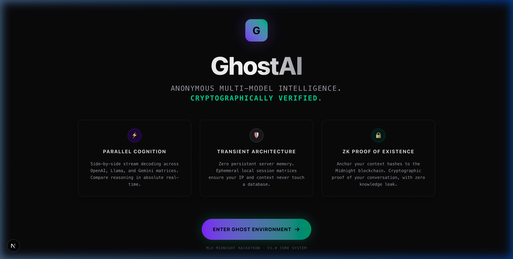
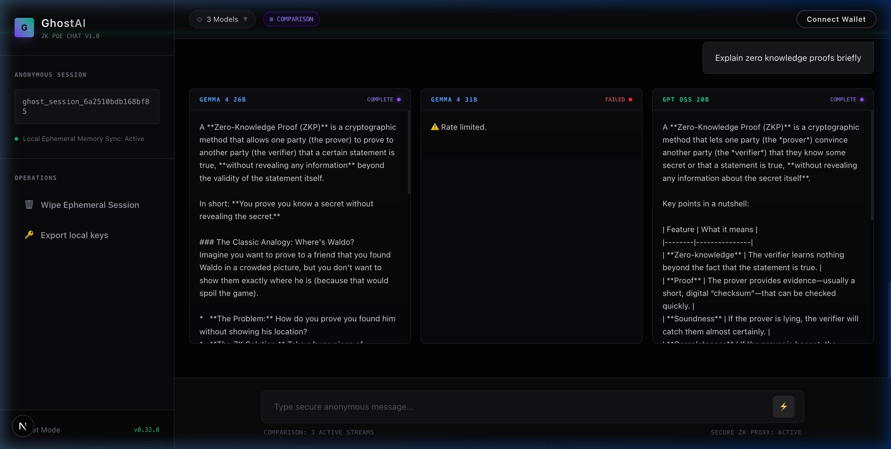
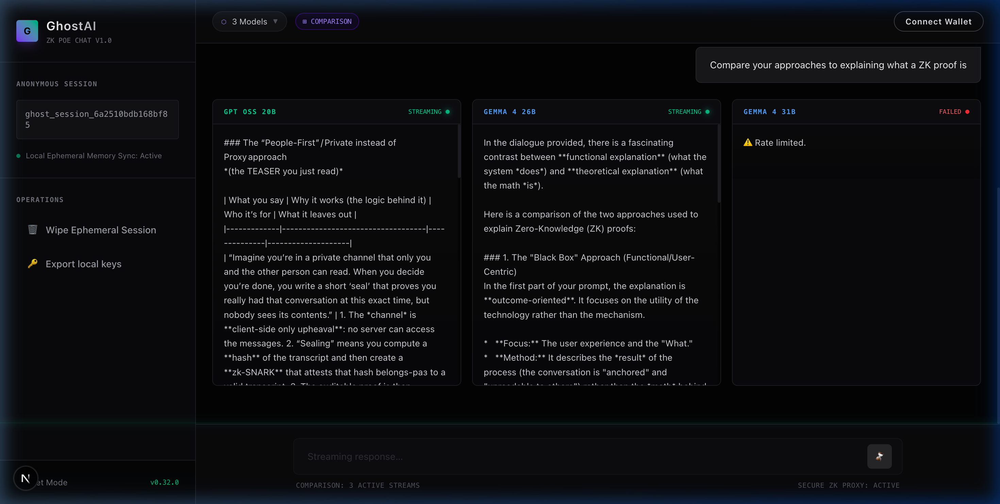
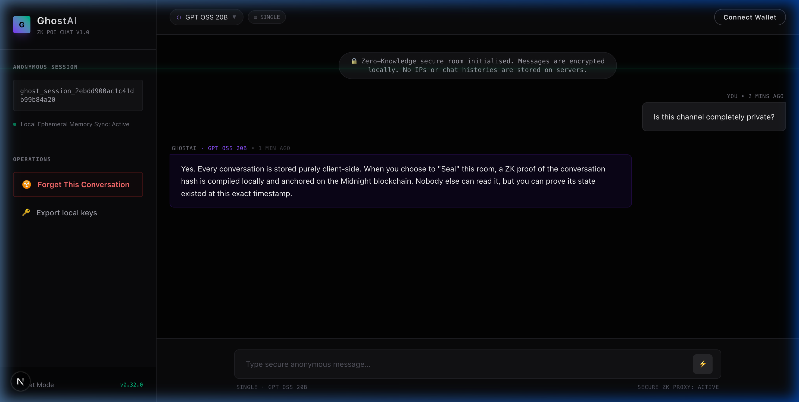

<div align="center">

# ◈ GhostAI

### *Ephemeral. Parallel. Cryptographically Sealed.*

**Anonymous multi-model AI comparison engine secured by Midnight zero-knowledge proof verification.**



[](https://nextjs.org/)
[](https://openrouter.ai/)
[](https://midnight.network/)
[](https://mlh.io/)

</div>

---

## ◈ The Problem with Every Other AI Interface

Every mainstream AI interface leaves a trace.

When you query ChatGPT, Claude, or Gemini, your device fingerprint is logged. Your session cookies are persisted. Your conversation metadata is indexed. Your IP is stored. Your prompt embeddings may be retained for training. The conversation you believe is private is, at minimum, cached in a server buffer you will never control.

**GhostAI operates on a fundamentally different contract.**

Zero server-side conversation storage. Zero persistent cookies. Zero device fingerprint retention. The instant you close the tab, the session evaporates — not into an archive, not into a log — into nothing. And when you need to *prove* a conversation happened? You commit a cryptographic SHA-256 hash to the Midnight blockchain, anchoring your proof to an immutable ledger without ever exposing the plaintext content.

This is not a privacy checkbox. This is a privacy-first architecture.

---

## ◈ Core Feature Walkthrough

### 1. Anonymous Nodes — Zero Footprint Sessions

GhostAI initializes a new cryptographically random session ID (`crypto.randomUUID()`) on every page load. This UUID lives exclusively in the browser's `sessionStorage` — not in `localStorage`, not in a cookie, not on any server. The moment the browser tab closes, the session matrix is permanently destroyed with no recovery vector.

```
Session Lifecycle:
   Tab Open → UUID Generated → [sessionStorage only] → Tab Close → GONE
   No server log. No database row. No trace.
```

### 2. Parallel Comparison Matrix — Side-by-Side Streaming

Select between 1 and 3 models from the GhostAI model registry and activate **Comparison Mode**. A single prompt fans out to independent parallel streams simultaneously, rendering responses side-by-side in real time.

**Available Model Matrix:**
| Provider | Model | Context |
|---|---|---|
| OpenAI | `gpt-oss-20b:free` | 200K |
| Meta | `llama-3.3-70b-instruct:free` | 128K |
| Nvidia | `nemotron-3-ultra-550b-a55b:free` | 131K |
| Nvidia | `nemotron-3-super-120b-a12b:free` | 131K |
| Nvidia | `nemotron-3-nano-omni-30b:free` | 32K |
| Nvidia | `nemotron-3.5-content-safety:free` | 32K |
| Google | `gemma-4-26b-a4b-it:free` | 8K |
| Cohere | `north-mini-code:free` | 256K |
| Poolside | `laguna-xs-2.1:free` | 32K |

Each model column streams independently — one timing out does not block or corrupt the others.



The backend `/api/chat` proxy rotates across three dedicated OpenRouter API keys mapped by column index, eliminating single-key rate limiting across the full 3-model comparison session.



---

### 3. Midnight Proof of Existence — Cryptographic Conversation Auditing

The **Seal Matrix** and **Verify Authenticity** functions form GhostAI's judge-facing cryptographic integrity engine:

```
SEAL WORKFLOW:
   1. User clicks "Seal Matrix"
   2. SHA-256 of full conversation text is computed client-side via Web Crypto API
   3. Hash + unix timestamp are passed to midnightBridge.ts
   4. Bridge invokes the Compact smart contract via the Lace wallet injected provider
   5. ZK proof is generated locally (no plaintext leaves the browser)
   6. Proof + hash are committed to the Midnight ledger
   7. Block number + Transaction ID returned → displayed in the Audit Banner

VERIFY WORKFLOW:
   1. User clicks "Verify Authenticity"
   2. Current visible conversation is re-hashed in-browser
   3. New hash is compared against the on-chain committed hash
   4. ✅ MATCHED → Authentic State Confirmed
   5. ❌ TAMPERED → Warning banner displays both hashes for forensic comparison
```

This architecture provides **non-repudiable proof of conversation integrity** without ever writing conversation plaintext to a blockchain, API log, or server buffer.

---

### 4. Panic Nuke Toggle — Instant State Destruction

The **Forget This Conversation** protocol executes a two-phase wipe:

**Phase 1 (Immediate, client-side):**
- Clears all React state buffers (messages, stream responses, ZK records)
- Wipes `sessionStorage` entirely
- Re-generates a new cryptographic `crypto.randomUUID()` session identity

**Phase 2 (Background, server-side):**
- Fires a `navigator.sendBeacon('/api/chat/purge')` request
- The purge endpoint flushes any mid-flight stream buffers upstream

The entire operation takes under 100ms. The UI transitions immediately with no confirmation dialogs, no second screens, no delays.



---

## ◈ Roadmap Horizon

- **E2E Encrypted History Persistence:** User-owned AES-256 encrypted conversation archives stored in Midnight smart contract tables — readable only by the user who holds the wallet key.
- **PDF & Document Understanding:** Multi-model parallel document analysis mode — drop a PDF and receive simultaneous interpretations from three independent reasoning engines.
- **Encrypted Smart Contract Tables:** Full on-chain encrypted storage of conversation metadata using Midnight's native shielded data structures — no centralized database, no admin access, ever.
- **Cross-Session Audit Trails:** Persistent ZK proof ledgers accessible via wallet authentication for long-running research and compliance workflows.
- **Model Latency Benchmarking Panel:** A real-time dashboard comparing time-to-first-token and streaming throughput across all active models in comparison mode.

---

## ◈ Technical Stack

| Layer | Technology |
|---|---|
| Frontend | Next.js 16 (Turbopack), Tailwind CSS |
| AI Backend | OpenRouter (multi-key proxy) |
| Blockchain | Midnight Network (Compact smart contracts) |
| Wallet | Midnight Lace |
| ZK Proofs | Midnight native ZK circuits |
| Session | Browser `sessionStorage` + `crypto.randomUUID()` |

---

<div align="center">

Built in 48 hours for the **MLH Midnight Hackathon 2026**.

*Leave no trace. Prove everything.*

</div>
