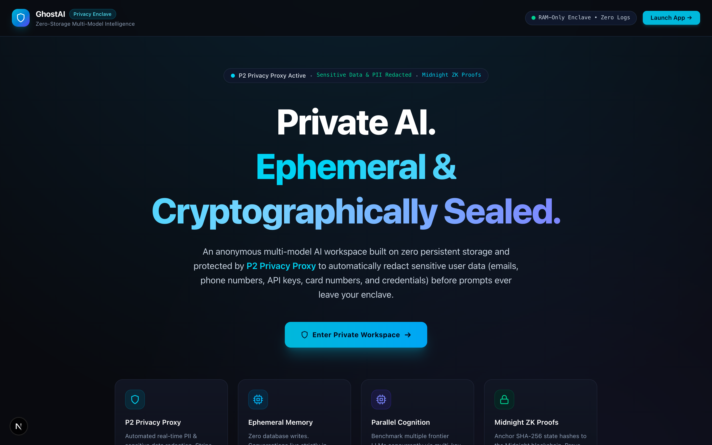
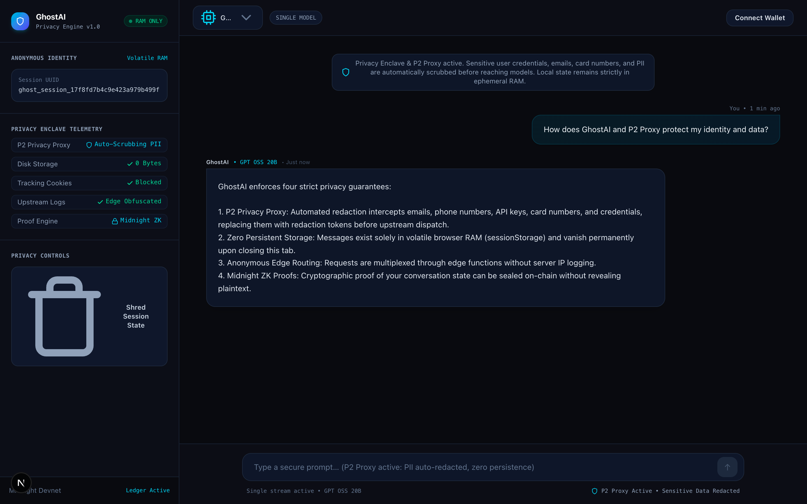
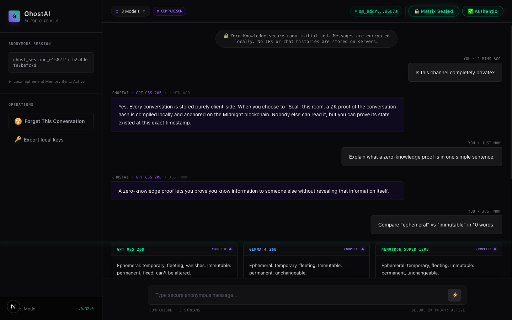
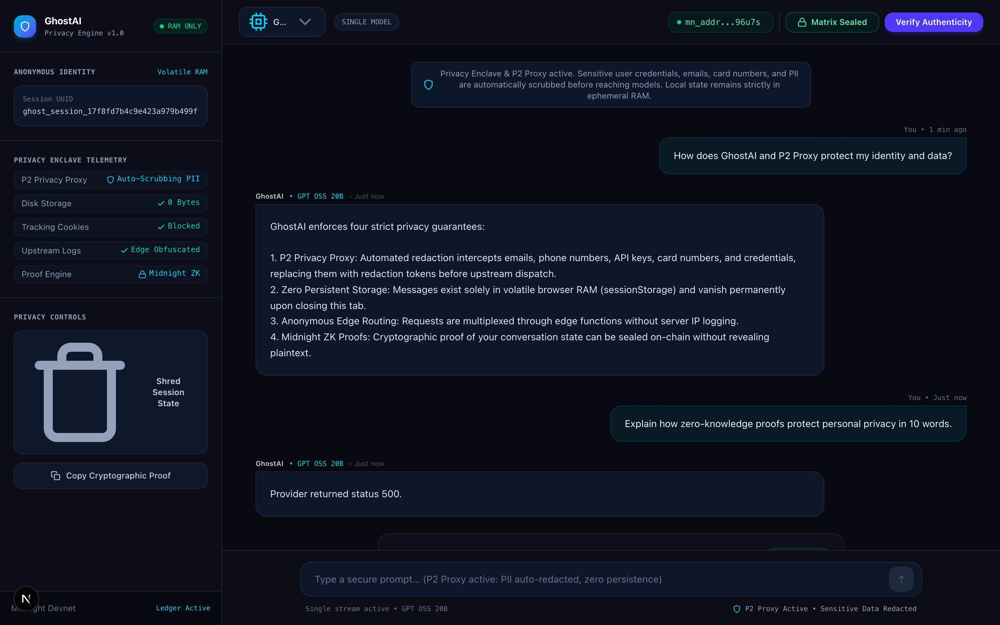
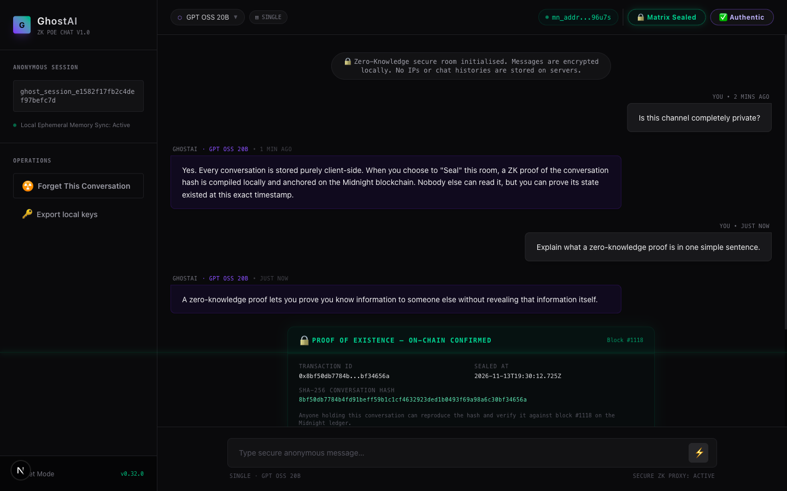
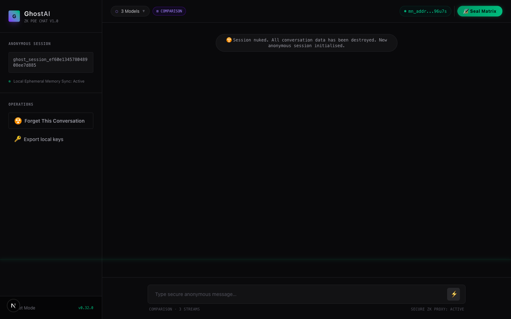

<div align="center">

# ◈ GhostAI

### *Privacy-First Multi-Model AI & Zero-Knowledge Verification Engine*

**Ephemeral, zero-storage multi-model AI comparison workspace featuring automated P2 sensitive data redaction and Midnight blockchain cryptographic integrity verification.**



[](https://nextjs.org/)
[](https://github.com/evoke147/ghost_ai)
[](https://midnight.network/)
[](https://openrouter.ai/)
[](https://mlh.io/)

</div>

---

## ◈ The Problem with Every Other AI Interface

Every mainstream AI interface leaves an indelible digital footprint:

When you query traditional chatbots, your device fingerprint is indexed, persistent session cookies are tracked, conversations are archived on centralized databases, your IP is cataloged, and prompt embeddings may be harvested for model training. Even "incognito" modes typically cache your prompts in unencrypted server memory buffers.

**GhostAI enforces an uncompromising zero-retention privacy contract:**

1. **P2 Privacy Proxy**: Automatically redacts sensitive user data (emails, API keys, credentials, phone numbers, payment cards, national IDs) client-side and at the edge proxy before prompts ever reach an AI model.
2. **RAM-Only Enclave**: Zero server-side conversation logs. Zero persistent cookies. Zero disk storage. Conversations exist strictly in volatile browser RAM (`sessionStorage`) and evaporate the moment you close your tab.
3. **Midnight Zero-Knowledge Proofs**: Anchor a client-side SHA-256 cryptographic digest to the Midnight blockchain ledger. Prove a conversation occurred at an exact block height with zero plaintext disclosure.

---

## ◈ Operational Dashboard Overview



---

## ◈ Core Architecture Pillars

### 1. P2 Privacy Proxy — Automated Sensitive Data & PII Redaction

Before any user prompt leaves your browser or arrives at third-party models (OpenAI, Google, NVIDIA, Cohere), it passes through the built-in **P2 Privacy Proxy** redaction engine:

- **API Keys & Secrets**: Detects and strips OpenAI (`sk-...`), Google (`AIza...`), GitHub tokens, AWS credentials, and private key blocks (`[REDACTED_API_KEY]`, `[REDACTED_PRIVATE_KEY_BLOCK]`).
- **Personally Identifiable Information (PII)**: Automatically sanitizes email addresses (`[REDACTED_EMAIL]`), international phone numbers (`[REDACTED_PHONE]`), and National IDs / SSNs (`[REDACTED_NATIONAL_ID]`).
- **Financial Identifiers**: Scans and sanitizes 16-digit payment card numbers (`[REDACTED_PAYMENT_CARD]`).
- **Network Identifiers**: Redacts raw IPv4 and IPv6 addresses (`[REDACTED_IP]`).

When sensitive identifiers are scrubbed, GhostAI provides real-time in-chat visual audit confirmation:

```
🛡️ P2 Redacted: 2 item(s) scrubbed (EMAIL, API_KEY)
```

Upstream models receive deterministic redaction tokens, allowing them to provide intelligent, contextual reasoning without ever possessing your confidential credentials or private identity.

---

### 2. Ephemeral Memory Enclave — Zero Footprint Sessions

GhostAI generates a cryptographically random session identifier (`safeRandomUUID()`) on each session initialization. This token resides strictly in browser volatile RAM (`sessionStorage`):

```
Session Lifecycle:
   Tab Open → UUID Generated → [sessionStorage only] → Tab Close → GONE
   Zero server database. Zero disk logs. Zero tracking cookies.
```

The real-time client-side privacy telemetry continuously audits storage boundaries:
- **Cookies**: `0 Detected (Blocked)`
- **LocalStorage**: `0 Bytes (RAM-Only)`
- **P2 Data Proxy**: `Active (0 PII Leaks)`
- **Server DB**: `None (Stateless Edge Proxy)`

---

### 3. Parallel Cognition Matrix — Side-by-Side Streaming



Switch between **Single Model Mode** and **Parallel Comparison Mode** directly from the header selector. A single prompt fans out concurrently to independent parallel streams, rendering side-by-side responses in real-time.

**Supported Frontier Model Matrix:**
| Provider | Model ID | Context Window | Mode |
|---|---|---|---|
| **OpenAI** | `gpt-oss-20b:free` | 200K | Single / Parallel |
| **Google** | `gemma-4-26b-a4b-it:free` | 8K | Single / Parallel |
| **Google** | `gemma-4-31b-it:free` | 8K | Single |
| **NVIDIA** | `nemotron-3-super-120b-a12b:free` | 131K | Single / Parallel |
| **NVIDIA** | `nemotron-3-ultra-550b-a55b:free` | 131K | Single / Parallel |
| **NVIDIA** | `nemotron-3-nano-omni-30b-a3b:free` | 32K | Single / Parallel |
| **NVIDIA** | `nemotron-3.5-content-safety:free` | 32K | Single / Parallel |
| **Cohere** | `north-mini-code:free` | 256K | Single / Parallel |
| **Poolside** | `laguna-xs-2.1:free` | 32K | Single / Parallel |

Each column stream decodes independently via Server-Sent Events (SSE). One model timing out or hitting rate limits never blocks or corrupts parallel sibling streams.

The `/api/chat` edge router rotates upstream API keys across columns and includes seamless fallback to Google Gemini when upstream provider quotas are reached.

---

### 4. Midnight Proof-of-Existence — Cryptographic Conversation Auditing

The **Seal Matrix** and **Verify Authenticity** features provide judge-verifiable cryptographic proof without revealing plaintext conversation content:

```
SEAL WORKFLOW:
   1. User clicks "Seal Matrix"
   2. Client-side SHA-256 hash of entire visible conversation is computed via Web Crypto API
   3. Hash + timestamp are passed to midnightBridge.ts
   4. Bridge invokes the Midnight Compact smart contract via Lace wallet injected provider
   5. Local ZK proof is compiled (no plaintext ever leaves the browser)
   6. Hash + proof are committed to the Midnight blockchain ledger
   7. Transaction ID + Block Height returned → displayed in Audit Certificate Banner
```



```
VERIFY WORKFLOW:
   1. User clicks "Verify Authenticity"
   2. Current conversation history is re-hashed dynamically in-browser
   3. Newly computed hash is matched against the on-chain committed digest
   4. ✅ MATCHED → "Authentic State Verified: Zero Tampering Detected"
   5. ❌ TAMPERED → Warning banner displaying both local and on-chain hashes
```



---

### 5. Cryptographic Shredder — Instant State Zeroization

The **Shred Session State** protocol executes a 2-phase destruction sequence with a 3-second auto-disarm safety window:



- **Phase 1 (Immediate Client-Side Wipe)**:
  - Zeroizes all React message buffers, stream responses, and ZK seal records.
  - Clears `sessionStorage` completely.
  - Re-initializes a fresh anonymous cryptographic UUID identity.
- **Phase 2 (Edge Connection Flush)**:
  - Dispatches an asynchronous `navigator.sendBeacon('/api/chat/purge')` request to flush mid-flight upstream streaming contexts.

---

## ◈ Technical Stack

| Layer | Technology |
|---|---|
| **Frontend Framework** | Next.js 16 (App Router, Webpack/Turbopack), React 19 |
| **Styling & Design System** | Tailwind CSS v4, Obsidian Privacy Palette, Custom Glassmorphism |
| **Privacy Redaction** | Custom P2 Privacy Proxy Engine (`p2Proxy.ts`) |
| **Cryptographic Hashing** | Web Crypto API (`SHA-256`), pure JS fallback (`jsSha256`) |
| **Blockchain & Smart Contracts** | Midnight Network (`proof-of-existence.compact`), Lace Wallet |
| **AI Inference** | OpenRouter (Multi-Key Matrix) + Google Gemini Edge Fallback |
| **Session Isolation** | Ephemeral Browser RAM (`sessionStorage` + `safeRandomUUID()`) |

---

## ◈ Quick Start & Local Development

### Prerequisites

- Node.js 20+ (recommended: Node 22+)
- npm, pnpm, or yarn

### 1. Clone & Install

```bash
git clone https://github.com/evoke147/ghost_ai.git
cd ghost_ai/ghost-ai-ui
npm install
```

### 2. Configure Environment

Create `.env.local` inside `ghost-ai-ui/`:

```env
# Google Gemini API key (fallback & inference)
GOOGLE_API_KEY=your_gemini_api_key

# Optional OpenRouter keys for multi-model matrix
OPENROUTER_API_KEY_1=your_openrouter_key_1
OPENROUTER_API_KEY_2=your_openrouter_key_2
OPENROUTER_API_KEY_3=your_openrouter_key_3

# Midnight Network Config
NEXT_PUBLIC_NETWORK_ID=undeployed
NEXT_PUBLIC_CONTRACT_ADDRESS=5681d5e55d4705159466441be78c1a5eaa80dd8a15d68a90166a0792ec3e9d97
```

### 3. Run Development Server

```bash
npm run dev
```

Open [http://localhost:3000](http://localhost:3000) in your browser.

### 4. Build for Production

```bash
npm run build
npm start
```

---

<div align="center">

Built for the **MLH Midnight Hackathon 2026**.

*Leave no trace. Redact sensitive data. Prove everything.*

</div>
