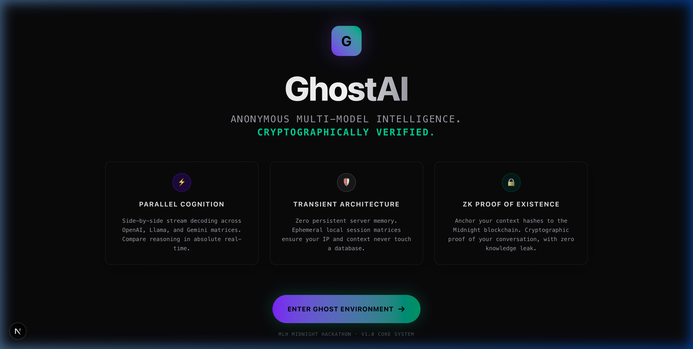
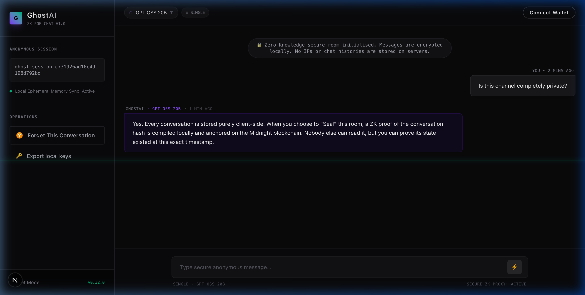

# GhostAI: Anonymous Multi-Model Intelligence & ZK Proof of Existence



GhostAI is a high-performance, parallel-streaming chat environment that leverages the Midnight blockchain for Zero-Knowledge Proofs of Existence. This document outlines the technical requirements, local configuration, and deployment procedures.

## 1. Prerequisites

Before initializing the GhostAI stack, ensure the following dependencies are installed and configured:

- **Node.js**: v18.17.0 or higher (v20+ recommended for Next.js Turbopack).
- **Docker Desktop**: Required to run the local Midnight node, ZK proof server, and Compact compiler container.
- **Midnight Lace Wallet**: Install the browser extension to interact with the DApp locally. Ensure it is configured to point to the local devnet.
- **Git**: For repository cloning and version control.

## 2. Local Environment Configuration

### Repository Setup
Clone the repository and install the Next.js dependencies:

```bash
git clone https://github.com/your-org/ghost-ai.git
cd ghost-ai/ghost-ai-ui
npm install
```

### Environmental Variables
GhostAI utilizes a dynamic multiplexing system for API requests to bypass rate limits during multi-model parallel comparisons. Create a `.env.local` file in the `ghost-ai-ui` directory:

```bash
touch .env.local
```

Populate it with the provided OpenRouter API keys. Ensure these keys are never committed to source control.

```env
# OpenRouter Proxy Keys - DO NOT COMMIT
OPENROUTER_API_KEY_1=sk-or-v1-xxxxxx
OPENROUTER_API_KEY_2=sk-or-v1-xxxxxx
OPENROUTER_API_KEY_3=sk-or-v1-xxxxxx

# Application State
NEXT_PUBLIC_ENVIRONMENT=development
```

> [!WARNING] 
> **Key Safety:** The `.env.local` file must remain in your `.gitignore`. If these keys are exposed, the parallel streaming engine will face immediate 429 Rate Limit floods.

## 3. Spinning Up the Stack

GhostAI requires both the blockchain infrastructure and the frontend client to be running simultaneously.

### Step 3A: Initialize Midnight Devnet
Navigate to the Midnight local environment directory to spin up the local blockchain ledger and proof server.

```bash
cd midnight-local-dev
docker compose up -d
```
*Verify that the containers (`midnight-node`, `proof-server`) are healthy via Docker Desktop.*

### Step 3B: Compile the Smart Contract
Navigate to the smart contract store and compile the Compact circuit.

```bash
cd ../hash-store
npm install
npm run compile
```
*This generates the ZK circuit artifacts required by `midnightBridge.ts` to seal conversation hashes.*

### Step 3C: Launch the GhostAI Client
Return to the Next.js frontend and start the development server using Turbopack for optimized HMR.

```bash
cd ../ghost-ai-ui
npm run dev
```
Navigate to `http://localhost:3000` to access the GhostAI Landing Environment.



## 4. Cloud Deployment (Production)

To deploy GhostAI for live hackathon judging, the architecture splits between a static/edge frontend and a robust backend proxy.

### Vercel Frontend Deployment
1. Connect your GitHub repository to Vercel.
2. Set the Root Directory to `ghost-ai-ui`.
3. In the **Environment Variables** panel, map your OpenRouter API keys exactly as they appear in `.env.local`:
   - `OPENROUTER_API_KEY_1`
   - `OPENROUTER_API_KEY_2`
   - `OPENROUTER_API_KEY_3`
4. Deploy the application. Vercel will automatically route the Next.js API endpoints (`/api/chat/route.ts`) to Edge Functions, ensuring minimal latency for the streaming responses.

### Render / Railway Network Proxy Configuration (Optional / Advanced)
If Vercel's 10-second serverless timeout becomes a bottleneck for heavy 120B parameter models during Comparison Mode, deploy a standalone proxy:
1. Extract `/api/chat` to a standalone Node.js/Express server.
2. Deploy the Express server to Render or Railway.
3. Configure the Render/Railway environmental variables with the OpenRouter key multiplexing matrix.
4. Update `GhostAiDashboard` in `page.tsx` to point the stream fetches to your new Render URL instead of the local Next.js route.
